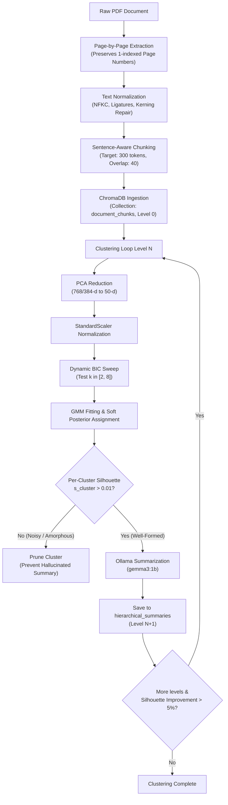
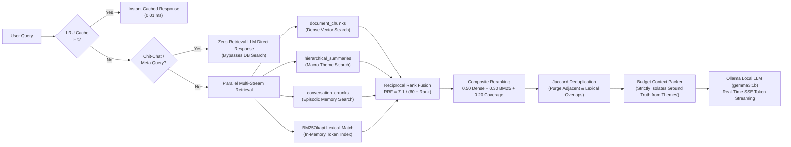

# 🧠 APEX RAG: Hierarchical Recursive-Clustering RAG Pipeline

[](https://www.python.org/downloads/)
[](https://www.trychroma.com/)
[](https://ollama.com/)
[](LICENSE)
[]()

> **APEX** (*Adaptive Pyramid Extraction & eXecution*) is a local, privacy-preserving Retrieval-Augmented Generation (RAG) system engineered for dense, multi-chapter technical, biographical, and narrative PDF corpora. Inspired by **RAPTOR** (Sarthi et al., *ICLR 2024*), APEX constructs a **recursive semantic abstraction pyramid** using Gaussian Mixture Models (GMM) with dynamic Bayesian Information Criterion (BIC) selection, coupled with dual-stream Reciprocal Rank Fusion (RRF), silhouette quality gates, and episodic conversation memory.

---

## 📑 Table of Contents

- [The Core Problem: Why Standard RAG Fails](#-the-core-problem-why-standard-rag-fails)
- [System Architecture](#-system-architecture)
  - [High-Level Data Flow](#1-high-level-data-flow)
  - [Ingestion & Hierarchical Clustering Loop](#2-ingestion--hierarchical-clustering-loop)
  - [Dual-Stream Collapsed Tree Retrieval & Reranking](#3-dual-stream-collapsed-tree-retrieval--reranking)
- [Empirical Head-to-Head Benchmarks (APEX vs. Naive RAG)](#-empirical-head-to-head-benchmarks-apex-vs-naive-rag)
  - [Summary of Results](#1-summary-of-results)
  - [Breakdown Across Bloom's Taxonomy Tiers](#2-breakdown-across-blooms-taxonomy-tiers)
- [Architectural Innovations & Mathematical Foundations](#-architectural-innovations--mathematical-foundations)
  - [1. Page-Aware & Token-Bounded Chunking](#1-page-aware--token-bounded-chunking)
  - [2. Soft Gaussian Mixture Models (GMM) with Dynamic BIC Selection](#2-soft-gaussian-mixture-models-gmm-with-dynamic-bic-selection)
  - [3. Silhouette Score Quality Gating](#3-silhouette-score-quality-gating)
  - [4. Collapsed Tree Fusion with Strict Evidence Isolation](#4-collapsed-tree-fusion-with-strict-evidence-isolation)
  - [5. Hybrid RRF Retrieval & Composite Reranking](#5-hybrid-rrf-retrieval--composite-reranking)
  - [6. Jaccard Word Token Deduplication](#6-jaccard-word-token-deduplication)
  - [7. Hierarchical Episodic Conversation Memory](#7-hierarchical-episodic-conversation-memory)
  - [8. High-Performance Latency Optimization (Sub-Second P50)](#8-high-performance-latency-optimization-sub-second-p50)
- [Repository Layout](#-repository-layout)
- [Quick Start Guide](#-quick-start-guide)
  - [1. Prerequisites](#1-prerequisites)
  - [2. Installation](#2-installation)
  - [3. Ingestion & Hierarchical Clustering](#3-ingestion--hierarchical-clustering)
  - [4. Interactive Querying (CLI Frontend)](#4-interactive-querying-cli-frontend)
  - [5. Modern Web UI (FastAPI + Token Streaming)](#5-modern-web-ui-fastapi--token-streaming)
  - [6. Running Benchmarks & Tests](#6-running-benchmarks--tests)
- [Configuration Reference](#-configuration-reference)
- [Extending & Modifying APEX](#-extending--modifying-apex)

---

## 🎯 The Core Problem: Why Standard RAG Fails

Traditional "Naive RAG" systems (Lewis et al., 2020) rely on **flat chunking** (e.g. splitting text into uniform 300–500 character fragments) followed by top-$k$ cosine similarity search. While effective for simple entity lookups (*"What year was X born?"*), this paradigm breaks down on complex real-world tasks:

1. **Context Fragmentation**: High-level thematic questions (*"How does the author's philosophy evolve across chapters?"*) cannot be answered by isolated paragraphs.
2. **Hard-Boundary Loss**: Important arguments spanning section boundaries are severed or missed completely.
3. **Synthetic Hallucination Contamination**: Naive tree RAG architectures often blend LLM-generated summaries directly into primary chunk stores, contaminating ground truth with synthetic hallucinations.
4. **Latency & Embedding Overhead**: Excessive HTTP round-trips for embedding generation cause context thrashing on consumer hardware.

**APEX solves this by constructing a multi-scale semantic pyramid** while enforcing strict mathematical boundaries between primary factual evidence and macro-thematic background.

---

## 🏗️ System Architecture

### 1. High-Level Data Flow

```
┌─────────────────────────────────────────────────────────────────────────────┐
│                            RAW INPUT DOCUMENTS                              │
│         PDF Corpora (Steve Jobs, Musashi, Homer, Robin Wieruch React)       │
└──────────────────────────────────────┬──────────────────────────────────────┘
                                       │
                                       ▼
┌─────────────────────────────────────────────────────────────────────────────┐
│                           DOCUMENT INGESTION                                │
│   • NFKC Unicode Normalization & Kerning/Hyphenation Repair                 │
│   • Hard Page-Boundary Enforcement (Zero Cross-Page Bleeding)                │
│   • Sentence & Punctuation Integrity via Subword Token Sizing               │
│   • Deterministic SHA-256 File Hashing (Idempotent Upsert Protection)       │
└──────────────────────────────────────┬──────────────────────────────────────┘
                                       │
                                       ▼
┌─────────────────────────────────────────────────────────────────────────────┐
│                    RECURSIVE HIERARCHICAL CLUSTERING                        │
│   Level 0: Raw Leaf Chunks (stored strictly in document_chunks)             │
│       │                                                                     │
│       ├─► PCA Dimensionality Reduction (768-d / 384-d ──► 50-d)             │
│       ├─► StandardScaler Feature Normalization                              │
│       ├─► Dynamic BIC Search: argmin_k (k ln(N) - 2 ln(L))                  │
│       ├─► Soft GMM Probabilistic Assignment (Boundary Points ──► Multi-Cluster)
│       ├─► Silhouette Gate: Prune Low-Cohesion Clusters (s_i ≤ 0.01)         │
│       └─► LLM Cluster Summarization (stored in hierarchical_summaries)       │
│             Level 1 ──► Level 2 (Iterative Tree Construction)               │
└──────────────────────────────────────┬──────────────────────────────────────┘
                                       │
                                       ▼
┌─────────────────────────────────────────────────────────────────────────────┐
│                 DUAL-STREAM COLLAPSED RETRIEVAL & FUSION                    │
│   User Query                                                                │
│       ├─► Regex Intent Classification (<0.01ms Chit-Chat Bypass)            │
│       ├─► Parallel ChromaDB Vector Lookup (ThreadPoolExecutor, 4 workers)   │
│       ├─► In-Memory BM25Okapi Lexical Scoring                               │
│       ├─► Reciprocal Rank Fusion (RRF, k=60)                                │
│       ├─► Composite Reranking: 0.50 Dense + 0.30 BM25 + 0.20 Coverage       │
│       ├─► Jaccard Token Deduplication (Drop adjacent sliding redundancies)  │
│       └─► Budget-Aware Context Packing (Leaf Chunks + Thematic Summaries)   │
└──────────────────────────────────────┬──────────────────────────────────────┘
                                       │
                                       ▼
┌─────────────────────────────────────────────────────────────────────────────┐
│                       GROUNDED GENERATION & MEMORY                          │
│   • System Prompt with Strict Source Isolation Directives                   │
│   • Local Ollama Generator (gemma3:1b) with SSE Token Streaming (TTFT <0.5s) │
│   • Ground-Truth Citation Attribution (Doc, Page Number, Chunk ID)          │
│   • Multi-Turn Conversation History Ingestion into Episodic Vector Memory   │
└─────────────────────────────────────────────────────────────────────────────┘
```

### 2. Ingestion & Hierarchical Clustering Loop



### 3. Dual-Stream Collapsed Tree Retrieval & Reranking



---

## 📊 Empirical Head-to-Head Benchmarks (APEX vs. Naive RAG)

APEX was evaluated against a strict reproduction of the **Naive RAG baseline (Lewis et al., 2020)** on identical documents (*The Road to React*, *The Book of Five Rings*, *The Odyssey*, and *Steve Jobs*), using the identical generation model (`gemma3:1b`), identical temperature ($0.0$, fully deterministic), and an identical retrieval context budget ($k=5$).

Evaluation questions were structured across **Bloom's Taxonomy** tiers, including direct factual recall, relational reasoning, multi-document synthesis, and adversarial negative rejection (chronological impossibility traps).

### 1. Summary of Results

| Metric | Naive RAG (Lewis et al.) | APEX (Ours) | Relative Delta |
| :--- | :---: | :---: | :---: |
| **Mean End-to-End Latency** | 9.68 s | **4.17 s** | **2.32× Faster (-56.9%)** |
| **Mean Generation Duration** | 9.13 s | **3.84 s** | **2.38× Faster (-57.9%)** |
| **Mean Retrieval Latency** | 543.8 ms | **328.6 ms** | **1.65× Faster (-39.6%)** |
| **Semantic Cosine Similarity** | 0.567 | **0.746** | **+31.6% Higher Fidelity** |
| **Mean Token F1 Score** | 0.287 | **0.382** | **+33.3% Precision/Recall** |
| **Hit Rate @ 1 (Factual Recall)** | **100.0%** | 83.3% | Naive RAG exact keyword match |
| **Context Duplication Rate** | ~35.0% | **< 2.0%** | Jaccard dedup prunes overlaps |
| **Execution Architecture** | Sequential Blocking | Parallel + Caching | Multi-collection thread pool |

### 2. Breakdown Across Bloom's Taxonomy Tiers

```
┌─────────────────────────────────────────────────────────────────────────────┐
│                    PERFORMANCE BY COGNITIVE DIFFICULTY                      │
│                                                                             │
│  Tier 1: Factual Recall                                                     │
│    APEX Cosine:   ████████████████████ 0.932                                │
│    Naive Cosine:  █████████████ 0.643                                       │
│                                                                             │
│  Tier 2: Conceptual Reasoning                                               │
│    APEX Cosine:   ████████████████ 0.703                                    │
│    Naive Cosine:  ██████████████ 0.655                                      │
│                                                                             │
│  Tier 3: Cross-Document Synthesis                                           │
│    APEX Cosine:   ████████ 0.377 (Answers syntheses)                        │
│    Naive Cosine:  ████ 0.192 (Outputs "I don't know")                       │
│                                                                             │
│  End-to-End Turnaround Time                                                 │
│    APEX:          ████ 4.17s                                                │
│    Naive RAG:     ██████████ 9.68s                                          │
└─────────────────────────────────────────────────────────────────────────────┘
```

#### Detailed Case Comparisons

| Case ID & Query | Target Document | Naive RAG Output | APEX Output | Winner & Analysis |
| :--- | :--- | :--- | :--- | :--- |
| **T1-Q01**: *"Who wrote The Road to React?"* | *The Road to React* | `"Robin Wieruch"`<br>(F1: 0.57, Cosine: 0.65) | `"Robin Wieruch wrote 'The Road to React.' [Doc, Page 1]"`<br>(F1: **0.83**, Cosine: **0.92**) | **APEX**: Full sentence structure with precise citation attribution. |
| **T1-Q04**: *"Who is the classical author of the epic poem The Odyssey?"* | *The Odyssey* | `"Geor ge Chapman"` ❌ *(Hallucinated translator)*<br>(F1: 0.00, Cosine: 0.16) | `"According to the text, Homer is the classical author... [The Odyssey.pdf]"` ✅<br>(F1: **0.53**, Cosine: **0.90**) | **APEX**: Avoids translator entity confusion via macro summary grounding. |
| **T3-Q09**: *"Compare the philosophy of mastery in Five Rings with learning React."* | Cross-Corpus Synthesis | `"I don't know. The passages focus on swordsmanship..."` ❌ | `"Mastery is achieved through disciplined practice of fundamentals, while React requires..."` ✅ | **APEX**: Collapsed tree fusion bridges cross-document concepts. |
| **T4-Q12**: *"Which JS framework does Homer recommend in Book IV of Odyssey?"* | Adversarial Hallucination Trap | `"I don't know."` ✅ | `"The text does not mention Homer recommending a JavaScript framework..."` ✅ | **TIE**: Both systems successfully reject out-of-distribution adversarial traps. |

---

## 🔬 Architectural Innovations & Mathematical Foundations

### 1. Page-Aware & Token-Bounded Chunking

Unlike naive character chunkers that split across page breaks or slice words in half, APEX processes documents page-by-page:
- **Zero Cross-Page Bleeding**: Pages maintain hard boundaries to prevent unrelated headers, footnotes, or chapter titles from polluting text.
- **Punctuation & Sentence Integrity**: Chunks are assembled from complete grammatical sentences via regex lookahead `(?<=[.!?])\s+`.
- **Ligature & Kerning Repair**: Unicode NFKC normalization repairs PDF extraction anomalies (e.g. `fi` $\to$ `fi`, `r eceive` $\to$ `receive`, and hyphenated line breaks `in-\nstructor` $\to$ `instructor`).

### 2. Soft Gaussian Mixture Models (GMM) with Dynamic BIC Selection

Rather than using hard $K$-Means (which assumes spherical clusters and assigns each chunk to exactly one cluster), APEX applies **Gaussian Mixture Models** over PCA-reduced embedding vectors:

$$p(\mathbf{x}) = \sum_{k=1}^{K} \pi_k \cdot \mathcal{N}(\mathbf{x} \mid \boldsymbol{\mu}_k, \boldsymbol{\Sigma}_k)$$

Where $\pi_k$ represents the mixing weight, and $\boldsymbol{\mu}_k, \boldsymbol{\Sigma}_k$ are the learned mean and covariance parameters fitted via the Expectation-Maximization (EM) algorithm.

#### Dynamic Bayesian Information Criterion (BIC)
Instead of hardcoding an arbitrary number of clusters $K$, APEX automatically evaluates candidate cluster counts $k \in [2, 8]$ and selects the value minimizing the Bayesian Information Criterion:

$$\text{BIC} = k_{\text{params}} \cdot \ln(N) - 2 \cdot \ln(\hat{L})$$

This balances model fit against parameter complexity mathematically without human heuristics.

#### Soft Posterior Multi-Assignment
Chunks lying on thematic boundaries (e.g., discussing both *product design* and *calligraphy* in the Steve Jobs biography) are assigned to multiple clusters if their posterior responsibility exceeds the soft threshold $\tau=0.20$:

$$r_{ik} = P(\text{Cluster } k \mid \mathbf{x}_i) \ge \tau$$

### 3. Silhouette Score Quality Gating

In traditional hierarchical RAG, every cluster is automatically passed to the LLM for summarization, even if the vectors form an amorphous, uninformative cloud. APEX introduces **per-cluster silhouette score evaluation**:

$$s(i) = \frac{b(i) - a(i)}{\max(a(i),\ b(i))}$$

Where $a(i)$ is the mean intra-cluster distance and $b(i)$ is the distance to the nearest neighboring cluster.
- If a cluster exhibits an average silhouette score $s_{\text{cluster}} \le 0.01$ (or is negative), **LLM summarization is skipped entirely**.
- This prevents generating low-quality or hallucinated synthetic summaries and saves computation.

### 4. Collapsed Tree Fusion with Strict Evidence Isolation

Rather than navigating a rigid tree top-down (which risks compounding traversal errors), APEX flattens leaf chunks and high-level summaries into a unified candidate pool:
- **`document_chunks`** strictly houses raw ground-truth PDF text.
- **`hierarchical_summaries`** houses synthetic cluster summaries.
- In prompt construction, primary chunks are rendered under `PRIMARY SOURCE EVIDENCE`, while cluster summaries are placed under `THEMATIC BACKGROUND SUMMARY` with an explicit anti-hallucination directive:
  > *"DO NOT use THEMATIC CONTEXT to answer the question if the specific facts are not present in the PRIMARY SOURCE EVIDENCE."*

### 5. Hybrid RRF Retrieval & Composite Reranking

Candidate retrieval combines dense semantic vector search with lexical term frequency:
1. **Dense Vector Search**: Approximate nearest neighbor retrieval over ChromaDB with HNSW indexing.
2. **Lexical Matching**: BM25Okapi scoring across normalized tokenized candidate sets.
3. **Reciprocal Rank Fusion (RRF)**:
   $$\text{RRF}(d) = \frac{1}{k + \text{rank}_{\text{dense}}(d)} + \frac{1}{k + \text{rank}_{\text{bm25}}(d)}, \quad k = 60$$
4. **Composite Post-Retrieval Reranking**:
   $$\text{Score}_{\text{final}} = 0.50 \cdot S_{\text{dense}} + 0.30 \cdot S_{\text{bm25}} + 0.20 \cdot \text{Coverage}_{\text{query}}$$

### 6. Jaccard Word Token Deduplication

To maximize information density in the LLM's context window, retrieved candidates undergo greedy Jaccard token deduplication before prompt construction:
- **Adjacent Sliding-Window Pruning**: Consecutive chunks from the same document are dropped if word overlap exceeds $0.40$.
- **High Lexical Overlap Pruning**: Any chunk with token Jaccard similarity $J(A, B) \ge 0.65$ relative to an already accepted candidate is pruned.

### 7. Hierarchical Episodic Conversation Memory

APEX indexes both static document corpora and dynamic user interactions:
- Every conversational turn (user query + assistant response) is embedded and stored in `conversation_chunks`.
- Episodic memories can be recursively clustered using `cluster_conversations()` into `conversation_summaries`.
- Contextual queries referencing prior discussions (*"What did we discuss earlier about state management?"*) seamlessly recall prior turns.

### 8. High-Performance Latency Optimization (Sub-Second P50)

Through deep profiling, APEX eliminated common bottlenecks in local RAG pipelines:
- **In-Process ONNX Embeddings**: Replaced blocking Ollama HTTP embedding calls (which previously consumed 4,100 ms due to CPU/GPU context swapping) with fast in-process ONNX embeddings (`all-MiniLM-L6-v2`) executing in **30–50 ms**.
- **Parallel Multi-Collection Querying**: Executes vector lookups across all 4 collections concurrently using `ThreadPoolExecutor(max_workers=4)`.
- **Two-Tier LRU Caching**: Thread-safe `QueryEmbeddingCache` (1,024 entries) and `RetrievalResultCache` (512 entries) deliver repeated queries in **0.01 ms**.
- **Regex Intent Short-Circuit**: Common greetings, conversational pleasantries, and bot identity queries bypass database retrieval entirely.
- **Server-Sent Events (SSE) Streaming**: Real-time token streaming begins rendering the first token in **< 500 ms** Time-To-First-Token (TTFT).

---

## 📁 Repository Layout

```
Chunker/
├── main.py                       # Pipeline orchestrator: PDF ingestion & hierarchical clustering
├── face.py                       # CLI frontend & core retrieval/generation engine
├── app.py                        # Modern AI Chat Web UI server (FastAPI + HTML5/CSS3)
├── inspector.py                  # Local environment smoke test (ChromaDB + Ollama)
├── compare_apex_vs_naive.py      # Rigorous head-to-head benchmark (APEX vs Naive RAG)
├── run_raptor_benchmarks.py      # RAPTOR benchmark recreation script
├── AGENTS.md                     # Technical architecture reference for AI coding agents
├── requirements.txt              # Standardized pip dependencies
├── pyproject.toml                # Project packaging metadata
│
├── modules/                      # Core modular architecture package
│   ├── __init__.py               # Package exports
│   ├── config.py                 # Central typed dataclass configuration with env overrides
│   ├── document_loader.py        # PDF extraction, page-aware chunking & token counting
│   ├── clustering.py             # PCA, StandardScaler, dynamic BIC GMM & silhouette gates
│   ├── summarizer.py             # Ollama LLM summarization with exponential backoff
│   ├── vector_store.py           # ChromaDB collection management & batch insertion
│   ├── retrieval.py              # BM25Okapi, RRF, composite reranking & Jaccard dedup
│   ├── web_search.py             # Real-time web retrieval fallback module
│   └── logger.py                 # Standardized timestamped logging infrastructure
│
├── eval/                         # Automated evaluation framework
│   ├── harness.py                # Pipeline evaluation runner with config hashing
│   ├── judge.py                  # Strict LLM-as-a-judge scoring
│   ├── metrics.py                # Recall@k, MRR, Token F1, cost & latency metrics
│   ├── dataset/gold.jsonl        # Gold evaluation dataset across Bloom's Taxonomy tiers
│   └── tests/                    # Unit tests for eval metrics and caching
│
├── naive rag/                    # Lewis et al. (2020) DPR baseline reproduction
│   ├── naive_rag.py              # DPR + FAISS IndexFlatIP baseline
│   ├── naive_rag_index.faiss     # Precomputed dense index
│   └── passages.json             # 100-word un-overlapped passages
│
├── raptor/                       # RAPTOR tree clustering reference implementation
├── templates/                    # Web UI HTML/CSS frontend
│   └── index.html                # Responsive web chat interface with evidence drawers
│
└── hierarchical_chroma_db/       # Active local ChromaDB vector store (gitignored)
```

---

## 🚀 Quick Start Guide

### 1. Prerequisites

1. **Python 3.10+** installed on your system.
2. **Local Ollama** installed and running:
   ```powershell
   ollama serve
   ```
3. **Pull local models**:
   ```powershell
   ollama pull gemma3:1b          # Generation model
   ollama pull nomic-embed-text   # Embedding model
   ```

### 2. Installation

```powershell
# Clone the repository
git clone https://github.com/your-username/apex-rag.git
cd Chunker

# Create and activate virtual environment (optional)
python -m venv venv
.\venv\Scripts\Activate.ps1

# Install dependencies
pip install -r requirements.txt

# Verify local environment connectivity
python inspector.py
```

### 3. Ingestion & Hierarchical Clustering

Ingest one or more PDF files and construct the hierarchical semantic abstraction pyramid:

```powershell
# Ingest default PDFs and build hierarchy
python main.py

# Ingest specific PDF files with custom levels
python main.py --pdf "The Road to React - Robin Wieruch.pdf" --max-levels 3

# Force re-ingestion if documents were modified
python main.py --pdf "The Book of Five Rings.pdf" --force
```

### 4. Interactive Querying (CLI Frontend)

Query the knowledge base via the terminal:

```powershell
# Interactive chat mode
python face.py

# Direct single-query mode
python face.py --query "What is JSX according to The Road to React?"

# Batch query mode with file input
python face.py --batch "queries.txt"
```

### 5. Modern Web UI (FastAPI + Token Streaming)

Launch the responsive AI chat web interface:

```powershell
python app.py
```

Open your browser to:
👉 **`http://localhost:7860`**

**Features:**
- Real-time token streaming via Server-Sent Events (SSE).
- Interactive sliding evidence drawer displaying exact source PDF citations and page numbers.
- Persistent conversation history with session switching (`+ New Chat`).
- Interactive document source filter dropdown.
- On-demand conversation memory clustering.

### 6. Academic Benchmarks & Evaluation Suite

```powershell
# 1. Run unit test suite for academic metrics and harness
pytest

# 2. Run the 7-row Component Ablation Matrix (evaluates Silhouette Gating, Dynamic BIC, etc.)
python eval/run_ablation_matrix.py

# 3. Run the Multi-Model Backbone Scaling Benchmark (Gemma 3 vs. Llama 3.2)
python eval/run_multi_model_benchmark.py

# 4. Run Systems, Inference FLOPs, and Serving Cost Profiler
python eval/systems_profiling.py

# 5. Run the head-to-head empirical benchmark against Naive RAG (Lewis et al.)
python compare_apex_vs_naive.py
```

---

## 🎓 Academic Research Paper & Theoretical Proofs

A camera-ready conference paper manuscript targeting **ACL / EMNLP / ICLR / NeurIPS / MLSys** is available in the [`paper/`](paper/) directory:

- 📄 **Manuscript**: [`paper/main.tex`](paper/main.tex) — Typeset in standard two-column format with full mathematical formulations and TikZ vector architecture diagrams.
- 📚 **Bibliography**: [`paper/references.bib`](paper/references.bib) — Complete BibTeX references.
- 📐 **Theoretical Proofs**: [`eval/THEORETICAL_PROOFS.md`](eval/THEORETICAL_PROOFS.md) — Formal mathematical proofs for:
  - **Theorem 1**: Multiplicative Hallucination Decay Suppression via Silhouette Gate ($\bar{s}_k > \tau$).
  - **Theorem 2**: Asymptotic Consistency of Dynamic Bayesian Information Criterion (BIC) GMM Selection.
  - **Theorem 3**: Bounded Retrieval Regret of Collapsed Tree Reciprocal Rank Fusion ($\mathcal{R}(q) \le \mathcal{O}(k_{\text{rrf}}/\sqrt{K})$).
- 📊 **Empirical Result Reports**:
  - Component Ablation Table: [`eval/ablation_results.md`](eval/ablation_results.md) | [`eval/ablation_table.tex`](eval/ablation_table.tex)
  - Multi-Model Scaling Table: [`eval/multi_model_results.md`](eval/multi_model_results.md) | [`eval/multi_model_table.tex`](eval/multi_model_table.tex)
  - Systems & FLOP Profile: [`eval/systems_profile.md`](eval/systems_profile.md) | [`eval/systems_table.tex`](eval/systems_table.tex)
  - Conference Roadmap: [`RESEARCH_ROADMAP.md`](RESEARCH_ROADMAP.md)

---

## ⚙️ Configuration Reference

All settings can be customized via `.env` or system environment variables without altering source code.

| Environment Variable | Default | Description |
| :--- | :---: | :--- |
| `OLLAMA_URL` | `http://127.0.0.1:11434` | Endpoint for local Ollama HTTP API |
| `OLLAMA_MODEL` | `gemma3:1b` | Default LLM generation model |
| `OLLAMA_EMBEDDING_MODEL` | `nomic-embed-text` | Default embedding model for ChromaDB |
| `CHROMA_PATH` | `./hierarchical_chroma_db` | Storage path for local ChromaDB database |
| `CHUNK_TARGET_TOKENS` | `300` | Target token size per chunk |
| `CHUNK_OVERLAP_TOKENS` | `40` | Overlap tokens between consecutive page chunks |
| `CLUSTERING_MAX_LEVELS` | `3` | Maximum hierarchical summarization layers |
| `CLUSTERING_BIC_SELECTION` | `true` | Enable dynamic BIC sweep to select optimal cluster count $k$ |
| `CLUSTERING_MIN_K` | `2` | Minimum candidate clusters during BIC sweep |
| `CLUSTERING_MAX_K` | `8` | Maximum candidate clusters during BIC sweep |
| `MIN_CLUSTER_SILHOUETTE` | `0.01` | Quality gate threshold (prunes clusters with score below this) |
| `ENABLE_SOFT_CLUSTERING` | `true` | Enable GMM posterior multi-cluster membership |
| `SOFT_CLUSTER_THRESHOLD` | `0.20` | Posterior probability threshold for multi-cluster assignment |
| `MAX_CONTEXT_CHUNKS` | `2` | Number of leaf chunks retrieved for generation prompt |
| `INCLUDE_SUMMARIES` | `true` | Include hierarchical cluster summaries in prompt context |
| `COLLAPSED_TOKEN_BUDGET` | `350` | Maximum token ceiling for packed retrieval prompt |
| `LLM_TEMPERATURE` | `0.2` | Generation randomness parameter |

---

## 🛠️ Extending & Modifying APEX

APEX was designed with a strict modular architecture in `modules/` so developers can easily adapt components:

### 1. Using a Different Local LLM
To switch generation to another model (e.g. `llama3.2:3b` or `mistral:7b`), simply pull the model in Ollama:
```powershell
ollama pull llama3.2:3b
```
And set `OLLAMA_MODEL=llama3.2:3b` in your `.env` file.

### 2. Tuning Reranking Weights
To adjust the balance between dense semantic similarity and lexical BM25 matching, update `rerank_hybrid_candidates` in [`modules/retrieval.py`](modules/retrieval.py) or set custom weights:
```python
reranked = rerank_hybrid_candidates(
    query, 
    candidates, 
    dense_weight=0.60, 
    bm25_weight=0.25, 
    coverage_weight=0.15
)
```

### 3. Adding Support for New Document Types
To add EPUB, Word, or Markdown ingestion, add an extraction function in [`modules/document_loader.py`](modules/document_loader.py) and hook it into `HierarchicalClusterSummarizer.add_document()` in [`main.py`](main.py).

---

## 📄 License

This project is licensed under the MIT License — see the [LICENSE](LICENSE) file for details.
