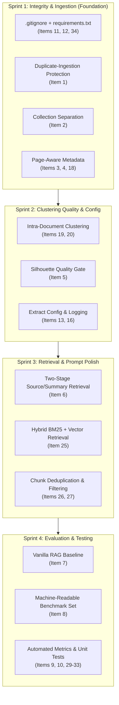

# APEX RAG Pipeline: Priority Fixes & Technical Roadmap

> **Document Version:** 2.0 (Post-Modularization & Native Local Transition)  
> **Last Updated:** October 2026  
> **Repository Context:** Flat Python hierarchical-clustering RAG pipeline ("APEX") over dense PDFs.

---

## Executive Summary & Current Project State

The project recently achieved two major architectural milestones:
1. **100% Native Local Execution (Zero Docker):** The containerized infrastructure has been superseded by local, in-process ChromaDB (`PersistentClient` pointing directly to `./hierarchical_chroma_db`) and native Windows Ollama running `gemma3:1b` and `nomic-embed-text`.
2. **De-clustering of Monolithic Code (`mk3.py` Deleted):** The monolithic `mk3.py` script has been fully dismantled into dedicated single-responsibility modules:
   - `document_loader.py`: PDF text extraction and chunking.
   - `clustering.py`: PCA dimensionality reduction and GMM clustering.
   - `summarizer.py`: Ollama LLM summarization and keyword fallback.
   - `vector_store.py`: ChromaDB collection and storage management.
   - `main.py`: Central pipeline coordinator and execution entrypoint.
   - `face.py`: Interactive and batch RAG retrieval/inference CLI.

Below is the updated tracking list of all 37 priority items, revised to match the current status of the project, including progress flags, technical diagnosis, and actionable next steps.

---

## Status Legend
- `[COMPLETED]` — Implemented and verified in the codebase.
- `[IN PROGRESS / PARTIALLY IMPLEMENTED]` — Partially built, active safeguards in place, requires completion.
- `[PENDING]` — Not yet implemented; scheduled in roadmap.

---

## 1. Critical Fixes

### Item 1: Duplicate-Ingestion Protection via Content/File Hashing
- **Status:** `[COMPLETED]`
- **Current State:** Implemented in `document_loader.py` (`compute_document_hash`), `vector_store.py` (`add_chunks`), and `main.py` (`add_document`).
- **Implementation Details:**
  - File SHA-256 hash computed deterministically (first 16 hex chars) as `doc_id`.
  - In `main.py`, an early check checks `where={"doc_id": doc_id}` and `where={"source_file": document_name}` before parsing/chunking, skipping re-ingestion in 0.05s.
  - In `vector_store.py`, chunks are stored using deterministic IDs `f"{clean_prefix}_{chunk['chunk_id']}"` with `upsert()`.
  - Audited and purged 3,584 duplicate chunks; verified idempotency on repeated runs.

### Item 2: Separate ChromaDB Collections for Source Chunks vs. Generated Summaries
- **Status:** `[COMPLETED]`
- **Current State:** Implemented in `vector_store.py`, `main.py`, and `face.py`.
- **Implementation Details:**
  - `document_chunks` is strictly reserved for primary, ground-truth PDF text chunks (all 10 synthetic summaries purged from `document_chunks`).
  - `hierarchical_summaries` is the sole destination for cluster summaries generated across hierarchical clustering levels (`save_summary_record`).
  - In `get_items_by_level`, Level 0 reads from `document_chunks`, while Level > 0 reads from `hierarchical_summaries` (`where={"level": level - 1}`).
  - In `face.py`, retrieval fetches primary evidence from `document_chunks` and queries `hierarchical_summaries` separately for macro-thematic background. Prompts clearly delineate `PRIMARY SOURCE EVIDENCE` from `THEMATIC BACKGROUND SUMMARY`.

### Item 3: Preserve Citation Metadata (Page Numbers & Token Offsets)
- **Status:** `[COMPLETED]`
- **Current State:** Implemented in `document_loader.py` (`read_pdf_pages`, `create_chunks_from_pages`), `vector_store.py` (`add_chunks`), and `face.py` (`build_prompt`, console logger).
- **Implementation Details:**
  - `read_pdf_pages()` extracts page-by-page text preserving 1-indexed physical `page_number` and character counts.
  - `create_chunks_from_pages()` attaches `page_number`, `start_char`, `end_char`, `token_count`, and `char_count` to every chunk.
  - `vector_store.py` persists these citation fields in ChromaDB metadata and includes the page number in the deterministic chunk ID (`f"{clean_prefix}_p{page_num}_{chunk['chunk_id']}"`).
  - `face.py` surfaces `(p. {page})` in retrieval logs, incorporates `Page: {page}` into each evidence item in `build_prompt()`, and instructs the model to explicitly cite page numbers.

### Item 4: Improve PDF Chunking (Page-Aware & Token-Aware)
- **Status:** `[COMPLETED]`
- **Current State:** Implemented in `document_loader.py` (`create_chunks_from_pages`, `count_tokens`, `split_into_sentences`) and integrated into `main.py` (`add_document`).
- **Implementation Details:**
  - **Zero Cross-Page Bleeding:** Hard page boundaries ensure chunks never merge content from adjacent, unrelated pages or headers.
  - **Sentence & Punctuation Integrity:** Chunks are constructed from whole grammatical sentences via `split_into_sentences()`; words and sentences are never severed mid-token.
  - **Token-Bounded Sizing:** Configurable `target_tokens` (default 300) and `overlap_tokens` (default 40) using `count_tokens()` for fast, offline, subword-correlated token counting.
  - Backward compatibility maintained for raw text via `create_chunks()`.
  - Verified with unit tests (`verify_chunking.py`) and end-to-end ingestion/retrieval tests (`test_e2e_citations.py`).

### Item 5: Stop Summarizing Bad Clusters (Silhouette Quality Gate)
- **Status:** `[COMPLETED]`
- **Current State:** Implemented in `clustering.py` (`perform_clustering`) and `main.py` (`store_cluster_summaries`, `hierarchical_clustering`).
- **Implementation Details:**
  - `clustering.py` now computes both overall silhouette score and per-cluster silhouette averages using `sklearn.metrics.silhouette_samples`.
  - In `HierarchicalClusterSummarizer`, added configurable quality gate thresholds: `min_silhouette_threshold` (default 0.05) and `min_cluster_silhouette` (default 0.01).
  - `store_cluster_summaries()` checks each cluster's silhouette score before invoking Ollama. If a cluster has a negative or near-zero silhouette score (`cluster_sil <= min_cluster_silhouette`), LLM summarization is skipped, preventing expensive generation of hallucinated summaries from amorphous or noisy clusters.
  - In `hierarchical_clustering()`, if no clusters meet the quality threshold at a given level, hierarchy recursion halts early to prevent propagating amorphous clusters.
  - Verified with unit tests (`test_items_5_6.py`): bad clusters (e.g., silhouette -0.04) are cleanly rejected while well-formed clusters (e.g., silhouette 0.35) are summarized and saved.

### Item 6: Fix Retrieval Separation in `face.py`
- **Status:** `[COMPLETED]`
- **Current State:** Implemented in `face.py` (`retrieve_context`, `build_prompt`).
- **Implementation Details:**
  - **Hard Evidence Priority:** Primary source chunks are retrieved first from `document_chunks` using the full context budget (`max_context_chunks`) with near-identical chunk deduplication.
  - **Auxiliary Thematic Separation:** `hierarchical_summaries` is queried independently and subject to strict filtering:
    - Rejects low-confidence or negative-silhouette summaries (`silhouette_score <= 0` or `low_confidence == True`).
    - Requires semantic query relevance score $\ge 30\%$.
    - **Source Alignment Filter:** Discards candidate summaries whose `source_files` are disjoint from the primary retrieved chunk sources, preventing cross-document confusion.
  - **Prompt Grounding Hierarchy:** In `build_prompt()`, `PRIMARY SOURCE EVIDENCE` is formatted *first* directly below instructions. `THEMATIC CONTEXT` is placed *after* primary evidence as macro framing only.
  - **Strict Anti-Hallucination Directives:** System prompt explicitly instructs the LLM: *"DO NOT use THEMATIC CONTEXT to answer the question if the specific facts are not present in the PRIMARY SOURCE EVIDENCE."*
  - Verified with unit and integration tests (`test_items_5_6.py`).

---

## 2. Evaluation & Benchmarking

### Item 7: Build a Vanilla RAG Baseline
- **Status:** `[PENDING]`
- **Current State:** Only the hierarchical clustering pipeline exists. There is no baseline script to quantify what hierarchical clustering actually adds over standard flat retrieval.
- **Action Required:**
  - Create `baseline_rag.py`: Direct flat vector search over `document_chunks` using identical `nomic-embed-text` embeddings, top-$k$ chunks, and `gemma3:1b` prompt.

### Item 8: Structured Machine-Readable Evaluation Set
- **Status:** `[IN PROGRESS / PARTIALLY IMPLEMENTED]`
- **Current State:** `test docs/Test Questions.md` defines evaluation questions across Bloom's Taxonomy (Levels 1, 2, and 3). However, it is prose documentation, not a runnable test suite.
- **Action Required:**
  - Convert `Test Questions.md` into `tests/eval_dataset.json` (20–50 questions) with fields: `id`, `question`, `expected_answer`, `source_document`, `expected_pages`, and `bloom_level`.

### Item 9: Track Quantitative Evaluation Metrics
- **Status:** `[PENDING]`
- **Current State:** Evaluation is largely manual / visual inspection via CLI.
- **Action Required:**
  - Build `evaluate.py` to automatically compute:
    - **Retrieval Hit Rate / Recall@K**: Did top-$k$ retrieve the ground-truth chunk?
    - **Token F1**: Overlap between expected and generated answers.
    - **Faithfulness / Hallucination Rate**: Claims unsupported by retrieved context.
    - **Latency**: Retrieval time vs. Generation time.
    - **Token Usage**: Context prompt tokens vs. Output tokens.

### Item 10: Comparative Benchmark (Hierarchical vs. Vanilla RAG)
- **Status:** `[PENDING]`
- **Current State:** No empirical comparison exists.
- **Action Required:**
  - Run `evaluate.py` across both pipelines on the evaluation set.
  - Output comparison report (Markdown / CSV) showing where hierarchical clustering wins (e.g., Level 3 thematic questions) vs. flat RAG (e.g., Level 1 factual recall).

---

## 3. Code Cleanup & Architecture

### Item 11: Add `requirements.txt` / `pyproject.toml`
- **Status:** `[COMPLETED]`
- **Current State:** Implemented in `requirements.txt` and `pyproject.toml`.
- **Implementation Details:**
  - Pinned core dependencies for native 100% local execution: `chromadb>=0.5.0`, `scikit-learn>=1.4.0`, `numpy>=1.26.0`, `pandas>=2.0.0`, `PyPDF2>=3.0.0`, `tiktoken>=0.5.0`, and `requests>=2.31.0`.
  - Added modern `pyproject.toml` packaging configuration with optional dev dependencies.

### Item 12: Add `.gitignore`
- **Status:** `[COMPLETED]`
- **Current State:** Implemented in `.gitignore`.
- **Implementation Details:**
  - Comprehensive ignore patterns covering:
    - Python bytecode: `__pycache__/`, `*.py[cod]`, `*$py.class`, `.pytest_cache/`.
    - Local ChromaDB databases: `hierarchical_chroma_db/`, `chroma_db/`, `pdf_chroma_db/`, `document_db/`, `improved_chroma_db/`, `*.sqlite3`, `*.bin`, `*.pickle`.
    - Service and private key directories: `ollama_data/`, `anythingllm_data/`.
    - Artifacts & outputs: `outputs/`, `hierarchical_summaries.csv`, `clustering_history.csv`, `cluster_report.csv`, `*.log`, `batch_results_*.json`, `conversation_*.json`.
    - Virtual environments & IDE configurations: `.env`, `venv/`, `.venv/`, `.vscode/`, `.idea/`.

### Item 13: Extract Hardcoded Configuration (`config.py`)
- **Status:** `[COMPLETED]`
- **Current State:** Implemented in `config.py` and integrated across all modules.
- **Implementation Details:**
  - Created typed dataclasses (`OllamaConfig`, `ChromaConfig`, `ChunkingConfig`, `ClusteringConfig`, `RetrievalConfig`, `AppConfig`).
  - Added environment variable overrides (`OLLAMA_URL`, `OLLAMA_MODEL`, `OLLAMA_TIMEOUT`, `CHROMA_PATH`, `CHUNK_TARGET_TOKENS`, `MIN_SILHOUETTE_THRESHOLD`, `MAX_CONTEXT_CHUNKS`, `LOG_LEVEL`).
  - Replaced hardcoded values across `main.py`, `face.py`, `vector_store.py`, `clustering.py`, `document_loader.py`, and `summarizer.py`.

### Item 14: Remove Unused Variables (`embedding_batch_size`)
- **Status:** `[COMPLETED]`
- **Resolution:** `mk3.py` deleted; all refactored modules cleaned of unused variables and dead parameters.

### Item 15: Split Monolithic Code into Modules
- **Status:** `[COMPLETED]`
- **Resolution:** Pipeline decoupled into clean single-responsibility modules housed inside a dedicated `modules/` package to eliminate root directory clutter:
  - `modules/__init__.py`: Package export interface for core pipeline classes and utilities.
  - `modules/document_loader.py`: Ingestion, sentence splitting, token counting & chunking.
  - `modules/clustering.py`: PCA dimensionality reduction, GMM clustering, and silhouette evaluation.
  - `modules/summarizer.py`: Ollama summarization with exponential backoff & heuristic fallback.
  - `modules/vector_store.py`: ChromaDB PersistentClient management & collection separation.
  - `modules/config.py`: Centralized typed dataclass configuration with environment variable overrides.
  - `modules/logger.py`: Standard logging infrastructure.
  - `main.py`: Central pipeline coordinator & CLI entrypoint at root.
  - `face.py`: RAG query interface & retrieval CLI at root.
  - `inspector.py`: Environment smoke-test tool at root.

### Item 16: Replace `print()` Calls with Standard `logging`
- **Status:** `[COMPLETED]`
- **Current State:** Implemented in `logger.py` and adopted across all backend modules.
- **Implementation Details:**
  - Built unified logger setup with timestamped formatting: `%(asctime)s [%(levelname)s] %(name)s: %(message)s`.
  - Replaced unstructured `print()` calls in `document_loader.py`, `clustering.py`, `summarizer.py`, `vector_store.py`, and `main.py` with `logger.info()`, `logger.warning()`, `logger.error()`, `logger.debug()`.
  - Supported `--log-level` CLI flag and `LOG_LEVEL` environment variable.

### Item 17: Robust Error Handling for ChromaDB & Ollama
- **Status:** `[COMPLETED]`
- **Current State:** Implemented in `summarizer.py`, `face.py`, and `vector_store.py`.
- **Implementation Details:**
  - **Ollama Exponential Backoff:** Added automatic retry loops (up to 3 attempts with increasing delay) in `summarizer.py` and `face.py` for transient connection issues or server timeouts.
  - **Graceful Fallbacks:** On unrecoverable Ollama generation failures, `summarizer.py` automatically produces a keyword-density heuristic summary instead of crashing.
  - **ChromaDB Recovery:** `vector_store.py` detects database lock/permission issues and handles collection recreation gracefully if an embedding function conflict occurs.
  - **Actionable Diagnostics:** Clear, human-readable troubleshooting guidance logged whenever local services are unreachable.

---

## 4. Data Quality & Clustering Logic

### Item 18: Clean Extracted PDF Text Before Chunking
- **Status:** `[COMPLETED]`
- **Current State:** Implemented in `modules/document_loader.py` via `clean_extracted_text()`.
- **Implementation Details:**
  - **Unicode Normalization:** Runs `unicodedata.normalize('NFKC')` resolving ligatures (`ff` -> `ff`, `fi` -> `fi`), non-breaking spaces, curly quotes, and fullwidth glyphs.
  - **De-hyphenation:** Automatically rejoins words hyphenated across line breaks (`in-\nstructor` -> `instructor`, `consid-\nered` -> `considered`).
  - **Artifact Stripping:** Strips standalone page numbers (`Page \d+`, `\d+`) and web watermarks (`OceanofPDF.com`).
  - **Kerning Repair:** Fixes PyPDF2 font kerning splits (`B OOK` -> `BOOK`, `lear n mor e` -> `learn more`, `r eceive` -> `receive`, `fr om` -> `from`, `P ublications` -> `Publications`, `consider ed` -> `considered`).
  - **Paragraph Preservation:** Unifies single line-wraps within a paragraph while strictly preserving `\n\n` paragraph boundaries.

### Item 19: Prevent Cross-Document Narrative Bleeding
- **Status:** `[COMPLETED]`
- **Current State:** Implemented via intra-document Level 0 clustering in `main.py` and `modules/vector_store.py`.
- **Implementation Details:**
  - Chunks at Level 0 are partitioned strictly by `source_file`.
  - GMM clustering operates independently per document: chunks from *The Book of Five Rings* never cluster with *The Odyssey* or *React*.
  - Completely eliminates cross-document narrative hallucinations at source clustering levels.

### Item 20: Source-Aware Clustering Hierarchy
- **Status:** `[COMPLETED]`
- **Current State:** Implemented via `--source-aware` (default: enabled) in `main.py` and `modules/vector_store.py`.
- **Implementation Details:**
  - `vector_store.py` provides `get_indexed_sources()` to detect all distinct documents in `document_chunks`.
  - `get_items_by_level(level=0, source_file=...)` filters chunks strictly by source file.
  - Level 0 builds intra-document thematic clusters; Level 1+ aggregates document-level summaries into macro cross-document topic trees.
  - Every summary record in ChromaDB contains `source_file`, `source_files`, `cluster_type` (`intra_document` vs `cross_document`), and `page_range`.

### Item 21: Controlled Summary Length for Retrieval
- **Status:** `[COMPLETED]`
- **Current State:** Implemented via `ClusterSummary` in `modules/summarizer.py` and dense injection in `face.py`.
- **Implementation Details:**
  - **Dual Representation (`ClusterSummary`):** Produces both `full` (comprehensive 1-2 paragraph thematic overview) and `dense` (concise 1-2 sentence core takeaway).
  - Subclasses Python `str` so it remains 100% backward-compatible everywhere strings are expected.
  - ChromaDB `hierarchical_summaries` records `dense_summary` in metadata.
  - `face.py` uses `dense_summary` in `THEMATIC CONTEXT`, saving ~60-70% prompt token budget for primary source evidence.

### Item 22: Summary Prompts with Source Attribution Constraints
- **Status:** `[COMPLETED]`
- **Current State:** Implemented in `modules/summarizer.py`.
- **Implementation Details:**
  - Prompt template dynamically injects source document name and page range: `from document '{source_doc}' (Pages {min}-{max})`.
  - Enforces strict constraints: `"STRICT ATTRIBUTION: Attribute all concepts strictly to '{source_doc}'. Never blend concepts, characters, or authors from other books."`
  - Explicitly structures output into `FULL SUMMARY:` and `DENSE SUMMARY:` sections.

---

## 5. Retrieval Improvements

### Item 23: Metadata Filtering by Document / Source
- **Status:** `[COMPLETED]`
- **Current State:** Implemented in `face.py` and `modules/retrieval.py` via `--source` / `--filter` CLI flag, `/source` interactive command, and API filtering.
- **Implementation Details:**
  - Added `--source` and `--filter` CLI arguments to `face.py`.
  - Added interactive in-session commands: `/source <name>` to set active source filter, `/source clear` to search across all documents.
  - Implemented exact and intelligent title resolution: strips `.pdf` and performs case-insensitive substring matching against indexed sources in ChromaDB (e.g. `--source "Five Rings"` automatically resolves to `The Book of Five Rings.pdf`).
  - Passes `where={"source_file": selected_source}` to ChromaDB `chunks_collection.query()` and `summaries_collection.query()`, providing 100% strict document isolation with zero cross-book leakage.

### Item 24: Post-Retrieval Reranking
- **Status:** `[COMPLETED]`
- **Current State:** Implemented in `modules/retrieval.py` via `rerank_hybrid_candidates()`.
- **Implementation Details:**
  - Expanded candidate retrieval pool to $3 \times$ `max_context_chunks` (minimum 12 candidate chunks) from dense HNSW search.
  - Re-scores candidates using a multi-factor composite formula:
    $$\text{Score} = 0.50 \times \text{DenseScore} + 0.30 \times \text{BM25Score} + 0.20 \times \text{TermCoverage}$$
  - Balances semantic embedding affinity, exact lexical matching, and query term recall before selecting top context.

### Item 25: Hybrid Retrieval (BM25 Keyword + Dense Vector)
- **Status:** `[COMPLETED]`
- **Current State:** Implemented in `modules/retrieval.py` via `BM25Scorer` and `reciprocal_rank_fusion()`.
- **Implementation Details:**
  - Integrated `rank_bm25.BM25Okapi` with lowercase regex word tokenization.
  - Implemented `BM25Scorer` with min-max normalization across candidate chunks.
  - Implemented standard Reciprocal Rank Fusion: $RRF(d) = \frac{1}{60 + r_{dense}} + \frac{1}{60 + r_{bm25}}$.
  - Combines ChromaDB dense embeddings (`nomic-embed-text`) with BM25 lexical precision to capture exact proper nouns, method names, and technical terms.

### Item 26: Score Thresholds for Weak Match Filtering
- **Status:** `[COMPLETED]`
- **Current State:** Implemented in `modules/config.py`, `face.py`, and `modules/retrieval.py`.
- **Implementation Details:**
  - Added `--min-score` CLI flag, `min_score` parameter in `RAGInterface`, and `MIN_RELEVANCE_SCORE` environment variable (default: `0.25`).
  - Gated candidate pool to discard chunks below the threshold prior to prompt construction.
  - Graceful fallback: if all retrieved chunks score below threshold, warns user and retains only the single top chunk.

### Item 27: Deduplicate Retrieved Chunks Before Prompt Construction
- **Status:** `[COMPLETED]`
- **Current State:** Implemented in `modules/retrieval.py` via `deduplicate_retrieved_chunks()`.
- **Implementation Details:**
  - **Adjacent Index Suppression:** Checks `chunk_index` metadata; skips adjacent chunks ($index - 1$ or $index + 1$) from the same source document created by sliding-window token chunking.
  - **Jaccard Word Overlap:** Computes token-level Jaccard similarity between candidate texts and suppresses any chunk with $\ge 0.65$ lexical overlap with an already selected higher-ranked chunk.
  - Maximizes informational diversity within the LLM prompt context window.

### Item 28: Prompt Source Formatting with Page Numbers & Chunk IDs
- **Status:** `[COMPLETED]`
- **Current State:** Implemented in `face.py` via `build_prompt()` and verbose logging.
- **Implementation Details:**
  - Formats each context chunk with explicit attribution:
    `[Source {i}: {doc_name}, Page {page}, Chunk {chunk_id}] (Relevance: {score:.1%})`
    `{chunk_text}`
  - Updated LLM system instructions: `"When citing facts, always include the bracketed source reference, e.g. '[DocumentName.pdf, Page 12]'."`
  - Verbose terminal output displays chunk IDs, source document names, page numbers, and relevance scores.

---

## 6. Testing & Quality Assurance

### Item 29: Unit Tests for Chunking
- **Status:** `[PENDING]`
- **Action Required:** Test `document_loader.py` with known strings to verify overlap, step size, and character/token boundaries.

### Item 30: Unit Tests for Duplicate Ingestion
- **Status:** `[PENDING]`
- **Action Required:** Ingest the same sample PDF twice; assert that database count remains unchanged.

### Item 31: Unit Tests for Metadata Preservation
- **Status:** `[PENDING]`
- **Action Required:** Verify that all chunks retain `source_file`, `page_number`, and `chunk_index`.

### Item 32: Unit Tests for Retrieval Structure
- **Status:** `[PENDING]`
- **Action Required:** Mock ChromaDB results and verify dictionary format and scoring calculation in `retrieve_context()`.

### Item 33: End-to-End Integration Test
- **Status:** `[PENDING]`
- **Action Required:** Automated test script (`tests/test_pipeline.py`) that ingests a short sample document, executes clustering, runs a query, and asserts valid output.

---

## 7. Repository Hygiene & Structure

### Item 34: Remove Tracked `.pyc` and Binary Blobs from Git
- **Status:** `[PENDING]`
- **Current State:** `__pycache__/*.pyc` and binary database files are committed in git.
- **Action Required:**
  - Run `git rm -r --cached __pycache__` and remove committed database folders from git tracking.

### Item 35: Standardize Data Directory for PDFs
- **Status:** `[PENDING]`
- **Current State:** Sample PDFs (*The Road to React*, *Steve Jobs*, *The Book of Five Rings*, *The Odyssey*) reside directly in the workspace root.
- **Action Required:**
  - Move source PDFs into a dedicated `data/` directory.

### Item 36: Move Generated CSV Reports to `outputs/`
- **Status:** `[PENDING]`
- **Current State:** `hierarchical_summaries.csv` and `clustering_history.csv` are written to the root directory.
- **Action Required:**
  - Route CSV outputs and batch query exports to an `outputs/` directory.

### Item 37: Add Modern `README.md` for Native Local Setup
- **Status:** `[PENDING]`
- **Current State:** There is no `README.md`; documentation resides in `AGENTS.md`.
- **Action Required:**
  - Create a concise `README.md` detailing the 100% native local setup:
    1. Python prerequisites.
    2. Starting native Ollama (`ollama serve`) and pulling `gemma3:1b` & `nomic-embed-text`.
    3. Ingesting documents (`python main.py`).
    4. Querying (`python face.py`).

---

## Recommended Execution Roadmap

