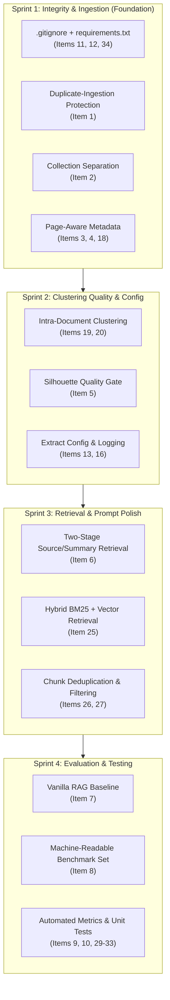

# APEX RAG Pipeline: Priority Fixes & Technical Roadmap

> **Document Version:** 2.0 (Post-Modularization & Native Local Transition)  
> **Last Updated:** October 2026  
> **Repository Context:** Flat Python hierarchical-clustering RAG pipeline ("APEX") over dense PDFs.

---

## Executive Summary & Current Project State

The project recently achieved two major architectural milestones:
1. **100% Native Local Execution (Zero Docker):** The containerized infrastructure has been superseded by local, in-process ChromaDB (`PersistentClient` pointing directly to `./hierarchical_chroma_db`) and native Windows Ollama running `gemma3:1b` and `nomic-embed-text`.
2. **De-clustering of Monolithic Code (`mk3.py` Deleted):** The monolithic `mk3.py` script has been fully dismantled into dedicated single-responsibility modules:
   - `document_loader.py`: PDF text extraction and chunking.
   - `clustering.py`: PCA dimensionality reduction and GMM clustering.
   - `summarizer.py`: Ollama LLM summarization and keyword fallback.
   - `vector_store.py`: ChromaDB collection and storage management.
   - `main.py`: Central pipeline coordinator and execution entrypoint.
   - `face.py`: Interactive and batch RAG retrieval/inference CLI.

Below is the updated tracking list of all 37 priority items, revised to match the current status of the project, including progress flags, technical diagnosis, and actionable next steps.

---

## Status Legend
- `[COMPLETED]` — Implemented and verified in the codebase.
- `[IN PROGRESS / PARTIALLY IMPLEMENTED]` — Partially built, active safeguards in place, requires completion.
- `[PENDING]` — Not yet implemented; scheduled in roadmap.

---

## 1. Critical Fixes

### Item 1: Duplicate-Ingestion Protection via Content/File Hashing
- **Status:** `[COMPLETED]`
- **Current State:** Implemented in `document_loader.py` (`compute_document_hash`), `vector_store.py` (`add_chunks`), and `main.py` (`add_document`).
- **Implementation Details:**
  - File SHA-256 hash computed deterministically (first 16 hex chars) as `doc_id`.
  - In `main.py`, an early check checks `where={"doc_id": doc_id}` and `where={"source_file": document_name}` before parsing/chunking, skipping re-ingestion in 0.05s.
  - In `vector_store.py`, chunks are stored using deterministic IDs `f"{clean_prefix}_{chunk['chunk_id']}"` with `upsert()`.
  - Audited and purged 3,584 duplicate chunks; verified idempotency on repeated runs.

### Item 2: Separate ChromaDB Collections for Source Chunks vs. Generated Summaries
- **Status:** `[COMPLETED]`
- **Current State:** Implemented in `vector_store.py`, `main.py`, and `face.py`.
- **Implementation Details:**
  - `document_chunks` is strictly reserved for primary, ground-truth PDF text chunks (all 10 synthetic summaries purged from `document_chunks`).
  - `hierarchical_summaries` is the sole destination for cluster summaries generated across hierarchical clustering levels (`save_summary_record`).
  - In `get_items_by_level`, Level 0 reads from `document_chunks`, while Level > 0 reads from `hierarchical_summaries` (`where={"level": level - 1}`).
  - In `face.py`, retrieval fetches primary evidence from `document_chunks` and queries `hierarchical_summaries` separately for macro-thematic background. Prompts clearly delineate `PRIMARY SOURCE EVIDENCE` from `THEMATIC BACKGROUND SUMMARY`.

### Item 3: Preserve Citation Metadata (Page Numbers & Token Offsets)
- **Status:** `[PENDING]`
- **Current State:** Chunk metadata currently stores `source_file`, `chunk_id`, `chunk_index`, `level`, `chunk_preview`, and `added_timestamp`. It lacks `page_number`, `start_offset`, `end_offset`, and `doc_hash`.
- **Action Required:**
  - Update `document_loader.py` to extract text page-by-page.
  - Track `page_number` (1-indexed), `start_offset`, and `end_offset` in character/token spans for each chunk.
  - Pass this rich metadata into ChromaDB so answers can cite specific pages (e.g., *"The Road to React, p. 42"*).

### Item 4: Improve PDF Chunking (Page-Aware & Token-Aware)
- **Status:** `[PENDING]`
- **Current State:** `document_loader.py` uses fixed 500-character windows with a 50-character overlap, splitting by double newlines when text is large. Character count is a poor proxy for semantic or token boundaries.
- **Action Required:**
  - Implement token-aware chunking using `tiktoken` (cl100k_base or gemma tokenizer) or sentence-aware boundary detection.
  - Enforce page boundaries so chunks do not bleed nonsensically across unrelated page headers.
  - Set default chunk sizes in tokens (e.g., 250–400 tokens with 40-token overlap).

### Item 5: Stop Summarizing Bad Clusters (Silhouette Quality Gate)
- **Status:** `[PENDING]`
- **Current State:** `main.py` clusters embeddings using GMM and calculates `silhouette_score`. However, even when the silhouette score is negative or near zero (e.g., `-0.0018` at Level 0 in `clustering_history.csv`), it still prompts Ollama to summarize all 8 ill-formed clusters.
- **Action Required:**
  - Add a silhouette threshold gate: if `silhouette_avg < 0.05` or clustering quality is poor, do not generate synthetic summaries for amorphous clusters.
  - Alternatively, mark them in metadata as `low_confidence: True` and exclude them from high-level retrieval.

### Item 6: Fix Retrieval Separation in `face.py`
- **Status:** `[IN PROGRESS / PARTIALLY IMPLEMENTED]`
- **Current State:** `face.py` now implements relevance clipping and low-confidence detection. However, prompt construction still retrieves cluster summaries based on the `cluster_id` metadata tag of returned chunks, blending them into the prompt.
- **Action Required:**
  - Two-stage retrieval: Query `document_chunks` first to establish hard, factual evidence.
  - Query `hierarchical_summaries` separately (or based on query relevance) to provide high-level context.
  - Ensure source chunks are the primary evidence anchor so generated summaries never override or hallucinate over source facts.

---

## 2. Evaluation & Benchmarking

### Item 7: Build a Vanilla RAG Baseline
- **Status:** `[PENDING]`
- **Current State:** Only the hierarchical clustering pipeline exists. There is no baseline script to quantify what hierarchical clustering actually adds over standard flat retrieval.
- **Action Required:**
  - Create `baseline_rag.py`: Direct flat vector search over `document_chunks` using identical `nomic-embed-text` embeddings, top-$k$ chunks, and `gemma3:1b` prompt.

### Item 8: Structured Machine-Readable Evaluation Set
- **Status:** `[IN PROGRESS / PARTIALLY IMPLEMENTED]`
- **Current State:** `test docs/Test Questions.md` defines evaluation questions across Bloom's Taxonomy (Levels 1, 2, and 3). However, it is prose documentation, not a runnable test suite.
- **Action Required:**
  - Convert `Test Questions.md` into `tests/eval_dataset.json` (20–50 questions) with fields: `id`, `question`, `expected_answer`, `source_document`, `expected_pages`, and `bloom_level`.

### Item 9: Track Quantitative Evaluation Metrics
- **Status:** `[PENDING]`
- **Current State:** Evaluation is largely manual / visual inspection via CLI.
- **Action Required:**
  - Build `evaluate.py` to automatically compute:
    - **Retrieval Hit Rate / Recall@K**: Did top-$k$ retrieve the ground-truth chunk?
    - **Token F1**: Overlap between expected and generated answers.
    - **Faithfulness / Hallucination Rate**: Claims unsupported by retrieved context.
    - **Latency**: Retrieval time vs. Generation time.
    - **Token Usage**: Context prompt tokens vs. Output tokens.

### Item 10: Comparative Benchmark (Hierarchical vs. Vanilla RAG)
- **Status:** `[PENDING]`
- **Current State:** No empirical comparison exists.
- **Action Required:**
  - Run `evaluate.py` across both pipelines on the evaluation set.
  - Output comparison report (Markdown / CSV) showing where hierarchical clustering wins (e.g., Level 3 thematic questions) vs. flat RAG (e.g., Level 1 factual recall).

---

## 3. Code Cleanup & Architecture

### Item 11: Add `requirements.txt` / `pyproject.toml`
- **Status:** `[PENDING]`
- **Current State:** Dependencies are implicit in the environment (`chromadb`, `scikit-learn`, `pandas`, `numpy`, `requests`, `PyPDF2`, `tiktoken`).
- **Action Required:**
  - Create a clean `requirements.txt` pinning compatible versions for local native execution.

### Item 12: Add `.gitignore`
- **Status:** `[PENDING]` (Critical for Repo Hygiene)
- **Current State:** Untracked/modified git status shows `__pycache__`, ChromaDB binary files, SQLite stores, model blobs, and CSV outputs being tracked.
- **Action Required:**
  - Create `.gitignore` ignoring `__pycache__/`, `*.pyc`, `hierarchical_chroma_db/`, `*.sqlite3`, `*.bin`, `ollama_data/`, `anythingllm_data/`, `outputs/`, and temporary CSVs.

### Item 13: Extract Hardcoded Configuration
- **Status:** `[PENDING]`
- **Current State:** In `main.py` and `face.py`, model names (`gemma3:1b`, `nomic-embed-text`), URLs, paths, and sample files (`Steve Jobs (1).pdf`) are hardcoded.
- **Action Required:**
  - Create `config.py` with dataclass/pydantic settings or environment variables (`OLLAMA_URL`, `GENERATION_MODEL`, `EMBEDDING_MODEL`, `CHROMA_PATH`, `CHUNK_SIZE`, `OVERLAP`, `MAX_LEVELS`).

### Item 14: Remove Unused Variables (`embedding_batch_size`)
- **Status:** `[COMPLETED]`
- **Resolution:** `mk3.py` has been deleted; the refactored `vector_store.py` and `main.py` eliminated dangling and unused variables.

### Item 15: Split Monolithic Code into Modules
- **Status:** `[COMPLETED]`
- **Resolution:** Successfully separated into:
  - `document_loader.py` (Ingestion & Chunking)
  - `clustering.py` (PCA & GMM Clustering)
  - `summarizer.py` (Ollama Summarization & Heuristics)
  - `vector_store.py` (ChromaDB Management)
  - `main.py` (Central Orchestrator & CLI)

### Item 16: Replace `print()` Calls with Standard `logging`
- **Status:** `[PENDING]`
- **Current State:** All modules use verbose `print()` statements.
- **Action Required:**
  - Introduce `import logging` across modules with configurable levels (`INFO`, `DEBUG`, `WARNING`).

### Item 17: Robust Error Handling for ChromaDB & Ollama
- **Status:** `[IN PROGRESS / PARTIALLY IMPLEMENTED]`
- **Current State:** Preflight checks exist in `face.py` and `summarizer.py`, and `face.py` catches timeouts and connection errors.
- **Action Required:**
  - Add retry backoff for Ollama generation requests and collection corruption recovery in `vector_store.py`.

---

## 4. Data Quality & Clustering Logic

### Item 18: Clean Extracted PDF Text Before Chunking
- **Status:** `[PENDING]`
- **Current State:** PyPDF2 text extraction outputs raw artifacts (hyphenated word splits like `in-\nstructor`, excessive whitespace, repeated headers/footers, and unprintable characters).
- **Action Required:**
  - Add a text cleaning pipeline in `document_loader.py`: normalize unicode, join hyphenated line-breaks, remove page headers/numbers, and collapse redundant whitespace while preserving paragraph markers.

### Item 19: Prevent Cross-Document Narrative Bleeding
- **Status:** `[PENDING]` (Critical for Semantic Accuracy)
- **Current State:** GMM clusters chunks across all ingested documents simultaneously. In `clustering_history.csv`, chunks from *The Book of Five Rings* and *The Odyssey* merged into one cluster, causing `gemma3:1b` to hallucinate that Miyamoto Musashi was held captive by Calypso.
- **Action Required:**
  - Cluster within individual documents first (intra-document clustering).
  - Only allow cross-document clustering at high levels (Level 2+) if explicitly requested for comparative synthesis.

### Item 20: Source-Aware Clustering Hierarchy
- **Status:** `[PENDING]`
- **Current State:** The clustering algorithm is source-agnostic at Level 0.
- **Action Required:**
  - Group chunks by `source_file` or `document_id` prior to Level 0 clustering.
  - Build hierarchical trees per document, then aggregate top-level document summaries.

### Item 21: Controlled Summary Length for Retrieval
- **Status:** `[PENDING]`
- **Current State:** Summaries in `hierarchical_summaries` can be several verbose paragraphs long, consuming prompt context when retrieved.
- **Action Required:**
  - Generate and store dual fields: `full_summary` (for detailed analysis) and `dense_summary` (1-2 sentences optimized for RAG context injection).

### Item 22: Summary Prompts with Source Attribution Constraints
- **Status:** `[PENDING]`
- **Current State:** The summarizer prompt asks for key themes without requiring document names or chunk IDs.
- **Action Required:**
  - Modify `summarizer.py` prompt template to require explicit citations of the source document and scope.

---

## 5. Retrieval Improvements

### Item 23: Metadata Filtering by Document / Source
- **Status:** `[PENDING]`
- **Current State:** Queries search the entire database across all books.
- **Action Required:**
  - Add `--source` or `--filter` argument to `face.py` and implement ChromaDB `where={"source_file": selected_source}` filtering.

### Item 24: Post-Retrieval Reranking
- **Status:** `[PENDING]`
- **Current State:** Chunks are ordered purely by bi-encoder vector similarity (`nomic-embed-text`).
- **Action Required:**
  - Integrate a lightweight cross-encoder reranker (e.g., `FlashRank` or `sentence-transformers/bge-reranker-base`) to re-score top-10 chunks down to top-5.

### Item 25: Hybrid Retrieval (BM25 Keyword + Dense Vector)
- **Status:** `[PENDING]`
- **Current State:** Only dense vector search is supported. Exact terms (names, dates, function names) can be missed if semantic similarity is diluted.
- **Action Required:**
  - Combine `rank_bm25` (already present in the environment) with Chroma vector retrieval using Reciprocal Rank Fusion (RRF).

### Item 26: Score Thresholds for Weak Match Filtering
- **Status:** `[IN PROGRESS / PARTIALLY IMPLEMENTED]`
- **Current State:** `face.py` detects low confidence ($< 25\%$) and warns the user.
- **Action Required:**
  - Provide an option to filter out chunks below a configurable similarity threshold before feeding them into the prompt.

### Item 27: Deduplicate Retrieved Chunks Before Prompt Construction
- **Status:** `[PENDING]`
- **Current State:** Sliding window chunking can cause near-identical overlapping chunks to fill the top-5 retrieved context.
- **Action Required:**
  - Deduplicate overlapping chunks by content similarity or adjacent chunk index before prompt assembly.

### Item 28: Prompt Source Formatting with Page Numbers & Chunk IDs
- **Status:** `[IN PROGRESS / PARTIALLY IMPLEMENTED]`
- **Current State:** `face.py` displays source document name and relevance percentage.
- **Action Required:**
  - Add page numbers and chunk spans once page-aware chunking (Item 3) is implemented.

---

## 6. Testing & Quality Assurance

### Item 29: Unit Tests for Chunking
- **Status:** `[PENDING]`
- **Action Required:** Test `document_loader.py` with known strings to verify overlap, step size, and character/token boundaries.

### Item 30: Unit Tests for Duplicate Ingestion
- **Status:** `[PENDING]`
- **Action Required:** Ingest the same sample PDF twice; assert that database count remains unchanged.

### Item 31: Unit Tests for Metadata Preservation
- **Status:** `[PENDING]`
- **Action Required:** Verify that all chunks retain `source_file`, `page_number`, and `chunk_index`.

### Item 32: Unit Tests for Retrieval Structure
- **Status:** `[PENDING]`
- **Action Required:** Mock ChromaDB results and verify dictionary format and scoring calculation in `retrieve_context()`.

### Item 33: End-to-End Integration Test
- **Status:** `[PENDING]`
- **Action Required:** Automated test script (`tests/test_pipeline.py`) that ingests a short sample document, executes clustering, runs a query, and asserts valid output.

---

## 7. Repository Hygiene & Structure

### Item 34: Remove Tracked `.pyc` and Binary Blobs from Git
- **Status:** `[PENDING]`
- **Current State:** `__pycache__/*.pyc` and binary database files are committed in git.
- **Action Required:**
  - Run `git rm -r --cached __pycache__` and remove committed database folders from git tracking.

### Item 35: Standardize Data Directory for PDFs
- **Status:** `[PENDING]`
- **Current State:** Sample PDFs (*The Road to React*, *Steve Jobs*, *The Book of Five Rings*, *The Odyssey*) reside directly in the workspace root.
- **Action Required:**
  - Move source PDFs into a dedicated `data/` directory.

### Item 36: Move Generated CSV Reports to `outputs/`
- **Status:** `[PENDING]`
- **Current State:** `hierarchical_summaries.csv` and `clustering_history.csv` are written to the root directory.
- **Action Required:**
  - Route CSV outputs and batch query exports to an `outputs/` directory.

### Item 37: Add Modern `README.md` for Native Local Setup
- **Status:** `[PENDING]`
- **Current State:** There is no `README.md`; documentation resides in `AGENTS.md`.
- **Action Required:**
  - Create a concise `README.md` detailing the 100% native local setup:
    1. Python prerequisites.
    2. Starting native Ollama (`ollama serve`) and pulling `gemma3:1b` & `nomic-embed-text`.
    3. Ingesting documents (`python main.py`).
    4. Querying (`python face.py`).

---

## Recommended Execution Roadmap

